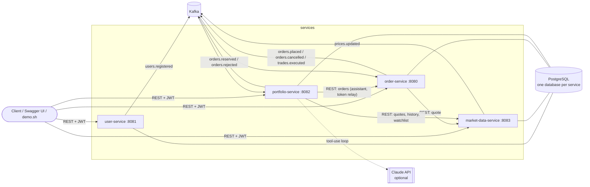
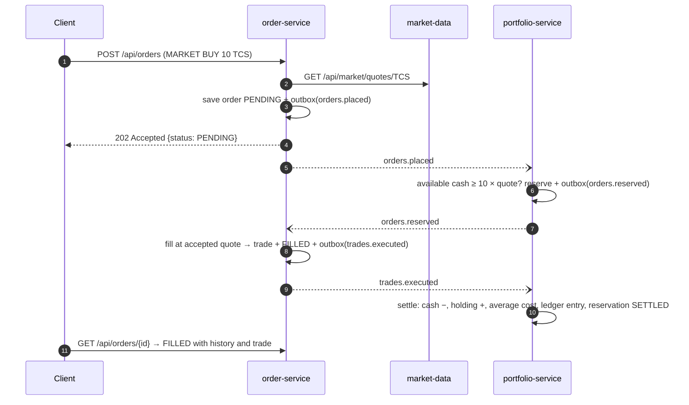

# TradeFlow

An event-driven, simulated stock-trading platform built with **Java 17, Spring Boot 4.1, Kafka and
PostgreSQL**: four microservices, a reliable order → reservation → execution → settlement saga,
portfolio analytics, and a read-only **AI portfolio assistant**.

> **All market prices are simulated.** They come from a seeded random walk over a fixed set of NSE
> ticker symbols and are not live market data. Nothing here is investment advice, and no real money
> or real orders are involved.

---

## Contents

1. [Architecture](#architecture)
2. [Key engineering decisions](#key-engineering-decisions)
3. [Quick start](#quick-start)
4. [Demo walkthrough](#demo-walkthrough)
5. [API overview](#api-overview)
6. [Configuration](#configuration)
7. [Databases: H2 vs PostgreSQL](#databases-h2-vs-postgresql)
8. [Kafka](#kafka)
9. [AI portfolio assistant](#ai-portfolio-assistant)
10. [Testing](#testing)
11. [Operations and troubleshooting](#operations-and-troubleshooting)
12. [Features, limitations, future work](#features-limitations-future-work)

---

## Architecture

| Service | Port | Owns | Database |
|---|---|---|---|
| `tradeflow-user-service` | 8081 | Registration, login, JWT issuing, demo users | `tradeflow_user` |
| `tradeflow-market-data-service` | 8083 | Instruments, deterministic simulated prices and history, watchlists, price alerts | `tradeflow_market_data` |
| `tradeflow-order-service` | 8080 | Order lifecycle, simulated execution, trades, order history | `tradeflow_order` |
| `tradeflow-portfolio-service` | 8082 | Cash accounts, reservations, holdings, ledger, analytics, reconciliation, AI assistant | `tradeflow_portfolio` |
| `tradeflow-common` | – | Event contracts, transactional outbox, idempotent consumer, Kafka error handling, JWT validation, RFC 9457 errors, money rules | – |



REST is used for synchronous reads (quotes, order lookups). Kafka carries every state change that
crosses a service boundary.

### The order saga



Rejections (`INSUFFICIENT_FUNDS`, `INSUFFICIENT_POSITION`) come back as `orders.rejected`. LIMIT orders
that are not marketable rest as `OPEN` with their cash/shares reserved, and fill on a later
`prices.updated` tick or release the reservation when cancelled. Full contract:
**[docs/EVENTS.md](docs/EVENTS.md)**.

---

## Key engineering decisions

| Decision | Why |
|---|---|
| **Saga with reservations** instead of a synchronous balance check | Funds and shares are earmarked atomically in portfolio-service before execution. Two concurrent orders can't both spend the same cash, and nothing needs a distributed transaction. |
| **Transactional outbox** (`outbox_events`) for every published event | An event exists if and only if its business change was committed. When Kafka is down, events queue up and are visible in `/actuator/health`; they are never lost or faked. |
| **Idempotent consumers** (`processed_events`, same DB transaction as the handler) + `UNIQUE(trade_id)` in the ledger | Kafka delivers at least once. Redeliveries are skipped, so trades are never double-counted. This is not "exactly-once", and the docs don't claim it. |
| **Explicit order state machine** (`OrderStatus.allowedNext()`) and an optimistic-lock `@Version` on orders, holdings, accounts | Invalid transitions return 409. A fill and a cancel can't both win. |
| **Quote-locked MARKET execution** | A MARKET order fills at the quote it was accepted at (the price funds were reserved at). That keeps execution deterministic and lets settlement provably fit inside the reservation. LIMIT orders fill at the tick price once it is at or better than the limit. Not an exchange matching engine; see limitations. |
| **Reconciliation job** | Every minute portfolio-service re-derives reserved cash, reserved shares, cash and quantities from reservations and the append-only ledger. Any mismatch is logged at ERROR and turns the `accounting` health indicator DOWN. DB `CHECK` constraints back up the domain invariants. |
| **`BigDecimal` everywhere with explicit rounding** | Cash and prices use 2 decimals and average cost uses 4, all with banker's rounding (`HALF_EVEN`), applied once at storage/report boundaries (`Money`). |
| **Stateless JWT (HS256)** issued by user-service, validated by every service | User ids come only from the token, never from request bodies or paths. Other users' orders and alerts return 404 so ids can't be probed. |
| **RFC 9457 `ProblemDetail` errors** with a stable `code` | e.g. `VALIDATION_FAILED`, `INSUFFICIENT_FUNDS`, `INVALID_STATE_TRANSITION`, `DEPENDENCY_UNAVAILABLE`. |
| **One shared library** (`tradeflow-common`) for cross-cutting infrastructure only | Business logic stays inside each service. |

---

## Quick start

### Prerequisites

* **JDK 17** and **Maven 3.9+**
* **Docker** (Docker Desktop, OrbStack or Colima) for the recommended setup. The full stack
  (7 containers) uses about **2.1 GiB** of memory and has per-container limits, so it fits in a
  4 GiB Docker VM.
* `curl` and `jq` for the demo script (`brew install jq`)

### Option A: everything in Docker (recommended)

```bash
cp .env.example .env          # optional: every value has a safe local default
make up                       # builds the 4 images, starts PostgreSQL, Kafka, Kafka UI and the services
make ps                       # wait until all services are "healthy"
make demo                     # scripted end-to-end walkthrough
```

### Option B: infrastructure in Docker, services from your IDE

```bash
make infra-up                 # PostgreSQL :5432, Kafka :9094, Kafka UI :8085
mvn -B install -DskipTests
# run each *Application class from the IDE, or:
java -jar tradeflow-user-service/target/tradeflow-user-service-0.0.1-SNAPSHOT-exec.jar
```

The default profile connects to `localhost:5432` and `localhost:9094`, which is exactly what
`make infra-up` exposes.

### Option C: no Docker (H2 + a native Kafka)

```bash
brew install kafka && brew services start kafka     # Kafka on localhost:9092
make run-h2 KAFKA=localhost:9092                    # file-based H2 in ~/.tradeflow/h2
make demo
make stop-h2
```

| URL | What |
|---|---|
| http://localhost:8080/swagger-ui.html | order-service API (also :8081, :8082, :8083) |
| http://localhost:8085 | Kafka UI (topics, messages, DLTs, consumer lag) |
| http://localhost:808x/actuator/health | health incl. `db`, `kafka`, `outbox`, `orderPipeline`, `accounting` |

**Demo users** (seeded on first start, `TRADEFLOW_DEMO_ENABLED=true`):
`demo@tradeflow.dev` and `admin@tradeflow.dev`, password `Demo@12345` (change via
`TRADEFLOW_DEMO_PASSWORD`). Every new account receives ₹10,00,000 of simulated cash.

---

## Demo walkthrough

`./scripts/demo.sh` (or `make demo`) runs this sequence and prints each result:

1. Health of all four services; log in as the demo trader and the demo admin.
2. Simulated quotes; add TCS and INFY to the watchlist.
3. **MARKET BUY 10 TCS** with an idempotency key → `202 PENDING` → `FILLED`; resubmit → `200`, same order.
4. **Oversized BUY** → `REJECTED / INSUFFICIENT_FUNDS` with the exact shortfall.
5. **LIMIT BUY** far below market → `OPEN`, cash reserved → cancel → reservation released.
6. Admin advances the simulated market; **SELL 4 TCS** → realized P&L against weighted-average cost.
7. Portfolio summary, risk report (allocation, HHI, drawdown) and performance history.
8. The **AI assistant** answers four questions; the last one ("Buy 100 RELIANCE for me") is refused.
9. Admin reconciliation of every account → `consistent: true`.

Manual examples:

```bash
TOKEN=$(curl -s localhost:8081/api/auth/login -H 'Content-Type: application/json' \
  -d '{"email":"demo@tradeflow.dev","password":"Demo@12345"}' | jq -r .accessToken)

curl -s localhost:8080/api/orders -H "Authorization: Bearer $TOKEN" -H 'Content-Type: application/json' \
  -d '{"symbol":"INFY","side":"BUY","type":"LIMIT","quantity":5,"limitPrice":1500.00,"clientOrderId":"my-key-1"}'

curl -s localhost:8082/api/portfolio/summary -H "Authorization: Bearer $TOKEN" | jq
curl -s localhost:8082/api/assistant/ask -H "Authorization: Bearer $TOKEN" -H 'Content-Type: application/json' \
  -d '{"question":"Which holdings have the highest concentration?"}' | jq
```

---

## API overview

| Service | Endpoint | Auth |
|---|---|---|
| user | `POST /api/auth/register`, `POST /api/auth/login`, `GET /api/users/me` | public / public / user |
| market-data | `GET /api/market/instruments`, `/quotes`, `/quotes/{symbol}`, `/history/{symbol}`, `/history?symbols=` | public |
| market-data | `GET /api/market/simulation`, `POST /api/market/simulation/advance?ticks=N` | public / **admin** |
| market-data | `GET /api/watchlist`, `PUT /api/watchlist/{symbol}`, `DELETE /api/watchlist/{symbol}` | user |
| market-data | `POST /api/alerts`, `GET /api/alerts?status=`, `DELETE /api/alerts/{id}` | user |
| order | `POST /api/orders`, `GET /api/orders/{id}`, `GET /api/orders?status=&symbol=&side=&from=&to=&page=&size=`, `POST /api/orders/{id}/cancel`, `GET /api/trades` | user |
| portfolio | `GET /api/portfolio/summary`, `/holdings`, `/performance`, `/risk`, `/transactions`, `/reconciliation` | user |
| portfolio | `POST /api/assistant/ask`, `GET /api/assistant/capabilities` | user |
| portfolio | `GET /api/admin/reconciliation` | **admin** |

Errors follow RFC 9457:

```json
{"type":"about:blank","title":"Conflict","status":409,"code":"INVALID_STATE_TRANSITION",
 "detail":"Order 3fbd… cannot move from CANCELLED to CANCELLED","instance":"/api/orders/3fbd…/cancel"}
```

---

## Configuration

Every setting can be overridden with an environment variable. Copy `.env.example` to `.env`
(git-ignored) for Docker Compose.

| Variable | Default | Used by |
|---|---|---|
| `SPRING_PROFILES_ACTIVE` | *(default = PostgreSQL)* | all; `h2` = file-based H2 |
| `SPRING_DATASOURCE_URL` | `jdbc:postgresql://localhost:5432/tradeflow_<service>` | all |
| `TRADEFLOW_DB_USERNAME` / `TRADEFLOW_DB_PASSWORD` | `tradeflow` / `tradeflow` (local container only) | all |
| `KAFKA_BOOTSTRAP_SERVERS` | `localhost:9094` (`kafka:29092` inside compose) | all |
| `TRADEFLOW_JWT_SECRET` | public local-only placeholder; **set a real ≥32-byte secret anywhere else** | all |
| `TRADEFLOW_DEMO_ENABLED` / `TRADEFLOW_DEMO_PASSWORD` | `true` / `Demo@12345` | user |
| `TRADEFLOW_MARKET_SEED` | `42` (same seed ⇒ same prices everywhere) | market-data |
| `TRADEFLOW_MARKET_TICKING` / `TRADEFLOW_MARKET_TICK_MS` | `true` / `30000` | market-data |
| `MARKET_DATA_SERVICE_URL` / `ORDER_SERVICE_URL` | `http://localhost:8083` / `:8080` | order, portfolio |
| `TRADEFLOW_INITIAL_CASH` | `1000000.00` | portfolio |
| `TRADEFLOW_AI_PROVIDER` | `none` (`anthropic` to enable Claude) | portfolio |
| `ANTHROPIC_API_KEY` | *(empty; never commit it)* | portfolio |
| `TRADEFLOW_AI_MODEL` | `claude-opus-5-5` | portfolio |
| `TRADEFLOW_H2_DIR` | `~/.tradeflow/h2` | `h2` profile |

---

## Databases: H2 vs PostgreSQL

| | PostgreSQL (default) | H2 file (`h2` profile) | H2 in-memory (`test` profile) |
|---|---|---|---|
| Purpose | Realistic dev/demo and deployment | Running without Docker | Fast automated tests |
| Data survives restart | Yes (Docker volume) | Yes (`~/.tradeflow/h2`) | No |
| Fidelity | Real locking, constraints, types | PostgreSQL compatibility mode, not the real thing | Same as H2 file |

* **Flyway owns the schema** in every profile. Hibernate runs with `ddl-auto=validate`, so a drift
  between entities and migrations fails at startup.
* The **same migration files** run on both engines. They use portable SQL only (`GENERATED BY DEFAULT
  AS IDENTITY`, `UUID`, `NUMERIC(19,4)`, `TIMESTAMP WITH TIME ZONE`, `CHECK` constraints).
* **H2 passing is not proof of PostgreSQL compatibility.** The `*PostgresCompatibilityTest` classes
  run each service against a real PostgreSQL 16: Flyway, Hibernate validation, `SELECT … FOR UPDATE`,
  `NUMERIC` precision, `CHECK` constraints. They use Testcontainers when Docker is available, otherwise
  genuine PostgreSQL binaries via zonky embedded-postgres:

  ```bash
  make test-postgres           # mvn verify -Ppostgres-tests
  ```

**Native PostgreSQL on macOS (no Docker):**

```bash
brew install postgresql@16 && brew services start postgresql@16
createuser -s tradeflow && psql -d postgres -c "ALTER USER tradeflow PASSWORD 'tradeflow'"
psql -d postgres -f init-db.sql          # creates the four databases
# then run the services with the default profile
```

Switching engines never migrates data: each profile has its own database, and Flyway refuses to
run against a non-empty schema it did not create. Nothing is silently erased.

---

## Kafka

* **Topics** (created on startup with 3 partitions, each with a `.DLT` twin): `users.registered`,
  `orders.placed`, `orders.reserved`, `orders.rejected`, `orders.cancelled`, `trades.executed`,
  `prices.updated`.
* **Serialization:** String key/value carrying a JSON envelope with `eventId` and `schemaVersion`
  (see [docs/EVENTS.md](docs/EVENTS.md)). Consumer group = `spring.application.name`.
* **Producer:** `acks=all`, idempotence on, sends time out after 5–10 s instead of hanging.
* **Compose listeners:** containers use `kafka:29092`, your Mac uses `localhost:9094`, and the KRaft
  controller uses 9093. Port 9094 avoids clashing with a Homebrew Kafka on 9092.
* **Kafka data is on a named volume** (`kafka_data`), like PostgreSQL. Never wipe Kafka storage while
  the services keep running: a fresh broker re-issues idempotent producer ids that running services still
  use, and some of their writes are then acknowledged as duplicates without being stored. `make reset`
  is safe because it stops every client at the same time.
* **When Kafka is unavailable:**
  * Order placement still succeeds (`202 PENDING`) because the event waits in the outbox.
  * The log explains what is wrong, and `/actuator/health` shows `kafka: DOWN` and then `outbox: DOWN`.
  * `orderPipeline` goes DOWN once orders sit in PENDING for more than two minutes.
  * Nothing reports success that didn't happen.

---

## AI portfolio assistant

`POST /api/assistant/ask` (portfolio-service) answers questions such as *"What is my portfolio worth?"*,
*"Which holdings have the highest concentration?"*, *"How has my portfolio changed?"*,
*"Summarize my watchlist"*, *"Explain max drawdown"* and *"What is the status of order …?"*.

**How it works**

* **Six read-only tools:** `get_portfolio_summary`, `get_risk_report`, `get_performance`,
  `get_watchlist_quotes`, `get_order`, `list_recent_orders`.
* **No tool takes a user id.** Every tool runs as the JWT's user, and order lookups go to order-service
  with the caller's own token. Another user's data is unreachable by construction.
* **No tool can place, change or cancel anything.** Trading requests are also refused up front,
  before any model call.
* **With `TRADEFLOW_AI_PROVIDER=anthropic` and `ANTHROPIC_API_KEY` set**, Claude (`claude-opus-5-5`,
  via the official Anthropic Java SDK) runs a tool-use loop over those tools.
  * **Cost and latency limits:** low effort, at most 4 tool rounds, 30 s per call, a 60 s overall
    deadline and 30 questions per user per hour.
  * **Refusal fallback:** server-side refusal fallback is enabled (`fallbacks: "default"`).
* **Without a provider, or whenever the provider fails** (bad key, rate limit, timeout, refusal,
  truncated output), answers come from deterministic templates filled with the same tool data. The
  response says so in `notice`. The rest of TradeFlow is unaffected.

**Every response separates**

* `answer` and `answerKind`: `AI_GENERATED_EXPLANATION` or `DETERMINISTIC_TEMPLATE`.
* `facts`: the raw tool results, each labelled `CALCULATED`, `RETRIEVED`, `SIMULATED_MARKET_DATA`,
  `REFERENCE` or `ERROR`.
* `mode`: `LLM`, `DETERMINISTIC` or `REFUSED`.
* `disclaimers`: simulated prices; not investment advice.

The system prompt forbids numbers that do not come from tool results and requires flagging
the model's own calculations.

---

## Testing

```bash
make test             # mvn verify: unit + H2 integration + embedded Kafka + in-JVM end-to-end
make test-postgres    # also the PostgreSQL compatibility tests
```

| Layer | Examples |
|---|---|
| Unit | Order state machine and limit marketability, placement validation and idempotency, average cost and realized P&L, HHI, drawdown, performance replay, simulator determinism and statistics, event codec, rupee formatting, assistant intent routing |
| Integration (H2, full Spring context) | Order lifecycle through listeners, cross-user isolation, pagination and filters, the saga's portfolio side incl. duplicates, inconsistent trades, reconciliation detecting tampered balances, auth flows, watchlists and alerts |
| Kafka (embedded broker, no Docker) | Outbox → Kafka → listener → reply event; redelivery de-duplication; malformed and inconsistent messages land in `<topic>.DLT` |
| AI provider | Real SDK against a local fake Messages API: tool loop, thinking-block echo, request shape, refusal/truncation/overload handling, round cap; graceful fallback when the provider is unreachable |
| PostgreSQL | Each service on real PostgreSQL 16 (Testcontainers or embedded binaries) |
| End-to-end | `tradeflow-e2e-tests` boots all four services in one JVM on an embedded Kafka broker and drives register → buy → rejections → limit + cancel → sell → analytics → reconciliation over HTTP |

CI (`.github/workflows/ci.yml`) runs `mvn verify -Ppostgres-tests` (Testcontainers on the GitHub
runner), validates the compose file and builds all four Docker images.

---

## Operations and troubleshooting

```bash
make up | make infra-up      # start
make ps                      # status and health
make logs S=order-service    # follow logs (omit S for all)
make down                    # stop, keep data
make reset                   # stop and delete the PostgreSQL and Kafka volumes (asks for confirmation)
make psql DB=tradeflow_portfolio
make topics                  # list Kafka topics
make dlt T=trades.executed   # inspect dead-lettered messages
```

Log lines carry `[requestId]` for HTTP requests (also returned as `X-Request-Id`) and
`[eventType:eventId]` while handling Kafka events.

| Symptom | Likely cause / fix |
|---|---|
| Orders stay `PENDING` | portfolio-service or Kafka down. Check `/actuator/health` on 8080/8082 (`kafka`, `outbox`, `orderPipeline`) and `make dlt T=orders.placed`. |
| `401 UNAUTHENTICATED` on every call | Token expired (8 h) or services started with different `TRADEFLOW_JWT_SECRET` values. |
| `ACCOUNT_NOT_FOUND` right after registering | The account is opened asynchronously; retry after a moment. If it persists, Kafka is not delivering `users.registered`. |
| Service fails at startup with a Flyway/validation error | The database was created by something else (e.g. old `ddl-auto=update` schema). Use a fresh database or `make reset`. |
| `Connection to localhost:9094 refused` | Kafka container not running (`make infra-up`), or you run Homebrew Kafka: set `KAFKA_BOOTSTRAP_SERVERS=localhost:9092`. |
| `accounting: DOWN` | Reconciliation found a mismatch; the ERROR log line `RECONCILIATION MISMATCH` names the user and check. |
| `docker: command not found` after installing Docker Desktop | Open a new terminal, or add `export PATH="$HOME/.docker/bin:$PATH"` to `~/.zshrc`. |
| A container is restarted with `OOMKilled` | Give Docker Desktop more memory (Settings → Resources) or stop Kafka UI: `docker compose stop kafka-ui`. |
| `<topic>.DLT` missing in Kafka UI | Expected on a fresh broker: dead-letter topics are created automatically on the first dead-lettered message. |

---

## Features, limitations, future work

**Implemented:**
* JWT auth with roles.
* Deterministic simulated market: 14 instruments, 90 ticks of seeded history, live ticks, admin
  advance.
* Watchlists and price alerts.
* MARKET/LIMIT orders with idempotency keys, cancellation, status history, filtering and pagination.
* Reservation-based saga with outbox and idempotent consumers.
* Settlement with weighted-average cost and realized/unrealized P&L.
* Append-only ledger; performance replay.
* Risk analytics: allocation, HHI, drawdown, warnings.
* Reconciliation with health reporting.
* DLT handling.
* AI assistant with honest fallback.
* Swagger UI; Docker Compose with health checks; Makefile; CI.

**Known limitations (deliberate scope):**
* No partial fills, no order expiry (LIMIT orders rest until filled or cancelled), no fees or
  taxes, long-only (no short selling), single currency (INR).
* MARKET orders fill at the quote accepted at placement. This is a simulation, not a matching engine.
* Price alerts are visible through the API only (no push notifications).
* The outbox publisher assumes one instance per service. Scaling out would need
  `SELECT … FOR UPDATE SKIP LOCKED` or leader election.
* HS256 shared secret: simple, but every service can mint tokens. RS256 + JWKS would fix that.
* No API gateway. The client calls each service directly.
* The assistant keeps no conversation memory (each question is independent).

**Future improvements:** an API gateway with a single origin and a small web dashboard; RS256/JWKS
or an OAuth2 authorization server; notification service consuming alert events; Testcontainers-based
Kafka tests; OpenTelemetry tracing across HTTP and Kafka; partial fills and an order book.

---

## Repository layout

```
pom.xml                      parent + aggregator (Spring Boot 4.1.1 dependency management)
tradeflow-common/            shared infrastructure library (+ test-jar with test helpers)
tradeflow-*-service/         the four services (src/main/resources/db/migration/<service>/ = Flyway)
tradeflow-e2e-tests/         in-JVM end-to-end test of all four services
docker-compose.yml, docker/  local environment and the service Dockerfile
Makefile, scripts/demo.sh    developer commands and the scripted demo
docs/EVENTS.md               event contract
```

> **Note on `tradeflow-user-service`:** it is still its own nested Git repository (remote
> `aravind19062/tradeflow-user-service`), recorded in this repo as a bare gitlink without
> `.gitmodules`. Fresh clones of this repo, including CI, will **not** contain it until it is
> converted to a regular directory or a proper submodule.
