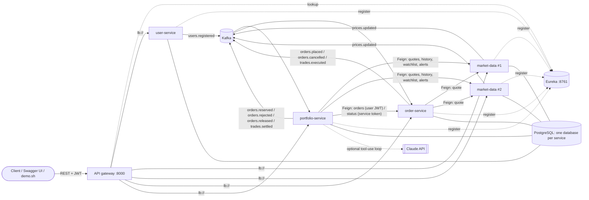

# TradeFlow

An event-driven, simulated stock-trading platform built with **Java 17, Spring Boot 4.1, Spring Cloud
2025.1, Kafka and PostgreSQL**. It has four business microservices behind an API gateway with Eureka
service discovery, a reservation-based order saga with timeouts and compensation, portfolio
analytics, and a read-only **AI portfolio assistant**.

> **All market prices are simulated.** They come from a seeded random walk over a fixed set of NSE
> ticker symbols and are not live market data. Nothing here is investment advice, there is no stock-price
> prediction, and no real money or real orders are involved.

---

## Contents

1. [Architecture](#architecture)
2. [The order saga](#the-order-saga)
3. [Key engineering decisions](#key-engineering-decisions)
4. [Quick start](#quick-start)
5. [Demo walkthrough](#demo-walkthrough)
6. [API overview](#api-overview)
7. [Configuration and security](#configuration-and-security)
8. [Databases: H2 vs PostgreSQL](#databases-h2-vs-postgresql)
9. [Kafka, delivery guarantees and dead letters](#kafka-delivery-guarantees-and-dead-letters)
10. [AI portfolio assistant](#ai-portfolio-assistant)
11. [Testing](#testing)
12. [Operations and troubleshooting](#operations-and-troubleshooting)
13. [Features, limitations, future work](#features-limitations-future-work)

---

## Architecture

| Component | Port | Responsibility |
|---|---|---|
| `tradeflow-api-gateway` | **8000** | Single external entry point (Spring Cloud Gateway, servlet). Checks JWTs and roles at the edge, routes via Eureka with load balancing, has a circuit breaker per route, serves the aggregated Swagger UI. Blocks `/internal/**`. |
| `tradeflow-discovery-server` | 8761 | Eureka registry; services register and find each other by name. |
| `tradeflow-user-service` | internal | Registration, login with throttling, JWT issuing, demo users (local profile only) |
| `tradeflow-market-data-service` | internal (×2 in Docker) | Deterministic simulated prices and history, watchlists, price alerts |
| `tradeflow-order-service` | internal | Order lifecycle, simulated execution, **order saga owner** (state, timeouts, recovery) |
| `tradeflow-portfolio-service` | internal | Cash, reservations, settlement, ledger, analytics, reconciliation (incl. cross-service), AI assistant |
| `tradeflow-common` | – | Event contracts, transactional outbox, idempotent consumer, DLT tooling, JWT, errors, money rules |



* **REST for queries, Kafka for state changes.** Synchronous calls go through **OpenFeign**, resolved by
  Eureka and load-balanced by **Spring Cloud LoadBalancer**. They are used only for reads (quotes, order
  lookups). Every cross-service state change is a Kafka event.
* **Registered is not the same as healthy.** Eureka lists instances that heart-beat. The gateway's and
  services' load balancers additionally poll each instance's `/actuator/health/readiness` (started +
  database reachable) and skip failing ones. Kafka is excluded from readiness on purpose: the outbox lets
  a service keep accepting work while Kafka is down.
* **Resilience.**
  * Feign timeouts: connect 2 s, read 5 s.
  * Resilience4j circuit breakers per client and per gateway route: open at 50% failures of the last 20
    calls, minimum 10. 4xx answers don't count as failures.
  * Exactly one load-balanced retry on another instance, for GET requests only. Nothing non-idempotent is
    retried.
  * Callers get an explicit 503 `DEPENDENCY_UNAVAILABLE`.

## The order saga

TradeFlow uses **choreography** (services react to each other's events) with an **explicit saga record**
owned by order-service (`order_sagas`: state, deadline, re-drive count). A recovery job acts on overdue
steps.

```
AWAITING_RESERVATION ─orders.reserved + fill──▶ AWAITING_SETTLEMENT ─trades.settled─▶ COMPLETED
        │            └orders.reserved, resting─▶ RESTING ─marketable tick─▶ AWAITING_SETTLEMENT
        ├─orders.rejected─────────────────────▶ REJECTED
        └─timeout────────┐          RESTING ─cancel / time-to-live─┐
                         ▼                                         ▼
                   RELEASE_REQUESTED ─orders.released─────────▶ RELEASED
AWAITING_SETTLEMENT ─3 re-drives without confirmation─▶ SETTLEMENT_FAILED  (needs an operator)
RELEASE_REQUESTED   ─3 re-sends without confirmation──▶ RELEASE_FAILED     (needs an operator)
```

| Forward step | Compensation / recovery |
|---|---|
| Reserve cash (BUY) or shares (SELL) in portfolio-service | **Release** via `orders.cancelled` → `orders.released`. Triggered by user cancel, limit-order expiry (default 1 day), or reservation timeout (default 2 min). |
| Reservation arrives after the order already ended | order-service immediately requests a release. A release that arrives *before* its reservation leaves a **tombstone**, so the late reservation is refused. |
| Trade executed but settlement not confirmed | **Never released** (the trade happened). The same trade is re-sent and portfolio de-duplicates by `trade_id`. After 3 attempts the saga is `SETTLEMENT_FAILED`, health goes DOWN, and an admin can retry after fixing the cause. |
| Release requested for an already-settled reservation | Portfolio refuses and answers `ALREADY_SETTLED`; the saga is flagged `RELEASE_FAILED`. |

**Detection beyond one database.** Portfolio-service runs **cross-service reconciliation** every 2
minutes. Reservations still ACTIVE after 5 minutes are compared with order-service's view (internal API,
SERVICE token):

| Finding | Action |
|---|---|
| Order ended without a fill | Leaked reservation, released automatically |
| Order FILLED | Unsettled fill, reported; the saga re-drives it |
| Order unknown | Orphan, reported for an operator |

Per-account reconciliation (ledger vs balances vs reservations) runs every minute in a snapshot
transaction. Details: [docs/EVENTS.md](docs/EVENTS.md).

## Key engineering decisions

| Decision | Why |
|---|---|
| **Reservation saga** with explicit state, timeouts and compensations | Two concurrent orders cannot both spend the same cash. Every in-flight order either completes or is compensated, without distributed transactions. |
| **Transactional outbox** (`outbox_events`, claimed with `FOR UPDATE SKIP LOCKED`) | An event exists if and only if its database change committed. Safe with several replicas. Kafka outages create a visible backlog, never silent loss. |
| **Idempotent consumers** (`processed_events`) + `UNIQUE(trade_id)` + row locks for settlement | Kafka is at-least-once. Duplicates, including concurrent ones, are skipped, so trades are never double-booked. This is not exactly-once. |
| **Optimistic locking** (`@Version`) on orders, accounts, holdings, reservations | A concurrent fill and cancel cannot both win. Conflicting event handlers are retried. |
| **Simulated execution, not a matching engine** | MARKET orders fill in full at the quote accepted at placement. LIMIT orders fill in full on a marketable simulated tick. No order book, no partial fills. |
| **Gateway + per-service JWT validation** | Defence in depth: the edge rejects bad tokens, and services validate again and derive the user id only from the token. Other users' resources return 404. |
| **Secure by default** | No JWT secret and no demo admin outside the explicit `local` profile. Services refuse to start with the public placeholder secret elsewhere. |

---

## Quick start

### Prerequisites

* JDK 17, Maven 3.9+
* Docker (Docker Desktop, OrbStack or Colima). The full stack (9 containers) uses about **2.8 GiB**;
  each container has a memory limit.
* `curl` and `jq` for the demo script

### Option A: everything in Docker (recommended)

```bash
cp .env.example .env     # optional; every value has a safe LOCAL default
make up                  # builds images, starts PostgreSQL, Kafka, Eureka, gateway, services (2 market-data replicas)
make ps                  # wait until everything is "healthy"
make demo                # scripted walkthrough through the gateway
```

| URL | What |
|---|---|
| http://localhost:8000 | API gateway (all `/api/**` routes) |
| http://localhost:8000/swagger-ui.html | Aggregated Swagger UI for all four services |
| http://localhost:8761 | Eureka dashboard (registered instances) |
| http://localhost:8085 | Kafka UI, after `make tools` |

The four services publish **no host ports**, so the gateway cannot be bypassed from your Mac.

### Option B: infrastructure in Docker, services from your IDE

```bash
make infra-up                                # PostgreSQL :5432, Kafka :9094
mvn -B install -DskipTests
# run TradeflowDiscoveryServerApplication, then the services and the gateway with SPRING_PROFILES_ACTIVE=local
```

### Option C: no Docker (H2 + native Kafka)

```bash
brew install kafka && brew services start kafka
make run-h2 KAFKA=localhost:9092   # 'h2' profile: file-based H2, no Eureka (fixed localhost ports), local profile implied
GATEWAY_URL= USER_URL=http://localhost:8081 ORDER_URL=http://localhost:8080 \
  PORTFOLIO_URL=http://localhost:8082 MARKET_URL=http://localhost:8083 ./scripts/demo.sh
```

**Demo users** (local profile only): `demo@tradeflow.dev` / `admin@tradeflow.dev`, password
`Demo@12345`. New accounts receive ₹10,00,000 of simulated cash.

## Demo walkthrough

`make demo` runs, through the gateway:

1. Log in as the demo trader and the demo admin.
2. Simulated quotes; add a watchlist.
3. **MARKET BUY** with an idempotency key → `202 PENDING` → `FILLED`. A resubmit returns `200` with the
   same order.
4. **Oversized BUY** → `REJECTED / INSUFFICIENT_FUNDS` with the exact shortfall.
5. **LIMIT BUY** far below the market → `OPEN` with cash reserved → cancel → reservation released.
6. Admin advances the simulated market; **SELL** → realized P&L against weighted-average cost.
7. Portfolio summary, risk report (allocation, HHI, drawdown), performance history.
8. **AI assistant**: four questions, the last one ("Buy 100 RELIANCE for me") refused.
9. Admin reconciliation of every account.

Load balancing is visible in the `X-Served-By` header:

```bash
for i in 1 2 3 4; do curl -s -D - -o /dev/null localhost:8000/api/market/quotes/TCS | grep -i x-served-by; done
```

## API overview

All paths are on the gateway (`http://localhost:8000`).

| Service | Endpoint | Auth |
|---|---|---|
| user | `POST /api/auth/register`, `POST /api/auth/login` (throttled), `GET /api/users/me` | public / public / user |
| market | `GET /api/market/instruments`, `/quotes`, `/quotes/{symbol}`, `/history/{symbol}`, `/history?symbols=` | public |
| market | `GET /api/market/simulation`, `POST /api/market/simulation/advance?ticks=N` | public / **admin** |
| market | `GET/PUT/DELETE /api/watchlist[/{symbol}]`, `POST/GET/DELETE /api/alerts[/{id}]` | user |
| order | `POST /api/orders`, `GET /api/orders/{id}`, `GET /api/orders?status=&symbol=&side=&from=&to=&page=&size=`, `POST /api/orders/{id}/cancel`, `GET /api/trades` | user |
| portfolio | `GET /api/portfolio/summary`, `/holdings`, `/performance`, `/risk`, `/transactions`, `/reconciliation` | user |
| portfolio | `POST /api/assistant/ask`, `GET /api/assistant/capabilities` | user |
| admin | `GET /api/admin/reconciliation`, `GET /api/admin/reconciliation/cross-service` | **admin** |
| admin | `GET /api/admin/orders/sagas?state=`, `POST /api/admin/orders/sagas/{orderId}/retry` | **admin** |
| admin | `GET /api/admin/{users\|market\|orders\|portfolio}/dlt/{topic}`, `POST …/dlt/{topic}/replay?partition=&offset=` | **admin** |

Errors use RFC 9457 `ProblemDetail` with a stable `code`, e.g. `VALIDATION_FAILED`, `INSUFFICIENT_FUNDS`,
`INVALID_STATE_TRANSITION`, `TOO_MANY_LOGIN_ATTEMPTS` (429 + `Retry-After`), `DEPENDENCY_UNAVAILABLE`
(503).

## Configuration and security

| Variable | Default | Notes |
|---|---|---|
| `SPRING_PROFILES_ACTIVE` | none (= PostgreSQL, secure) | `local` = public dev placeholders allowed; `h2` = no-Docker mode (implies `local`) |
| `TRADEFLOW_JWT_SECRET` | **required** outside `local` | ≥ 32 bytes, same value in all services and the gateway (`openssl rand -base64 48`) |
| `TRADEFLOW_DEMO_ENABLED` / `TRADEFLOW_DEMO_PASSWORD` | `false` / none (`true` / public password in `local`) | Outside `local`, needs a private password of 12+ characters |
| `SPRING_DATASOURCE_URL`, `TRADEFLOW_DB_USERNAME`, `TRADEFLOW_DB_PASSWORD` | local container values | |
| `KAFKA_BOOTSTRAP_SERVERS` | `localhost:9094` | `kafka:29092` inside Compose |
| `EUREKA_URL` | `http://localhost:8761/eureka` | |
| `TRADEFLOW_AI_PROVIDER`, `ANTHROPIC_API_KEY`, `TRADEFLOW_AI_MODEL` | `none`, unset, `claude-opus-5-5` | see the AI section |

**Security model**

* **Identity:** HS256 JWTs issued by user-service and validated at the gateway and again by every
  service. The user id always comes from the token; no endpoint accepts it from the caller.
* **Login protection:** BCrypt password hashing. Throttling locks an account after 5 failures in 15
  minutes, with a cap of 20 failures per client address.
* **Operational endpoints:** health details are visible only with an ADMIN token; anonymous callers see
  UP/DOWN. `/internal/**` accepts only short-lived SERVICE tokens and the gateway never routes it. The
  admin APIs require the ADMIN role.
* **Secrets:** never logged; `toString()` redacts JWT secrets, raw tokens and the API key. Commit no
  `.env` files.

## Databases: H2 vs PostgreSQL

| | PostgreSQL (default) | H2 file (`h2`) | H2 in-memory (`test`) |
|---|---|---|---|
| Purpose | Realistic runs and deployment | Running without Docker | Fast tests |
| Fidelity | Real locks, constraints, `SKIP LOCKED` | PostgreSQL compatibility mode | same as H2 file |

* **Schema:** Flyway owns it and Hibernate only validates it. The same migrations run on both engines.
* **H2 passing proves nothing about PostgreSQL:** the `*PostgresCompatibilityTest` classes run each
  service on real PostgreSQL 16 (`make test-postgres`), using Testcontainers, or embedded binaries when
  Docker is absent.

## Kafka, delivery guarantees and dead letters

* **Topics** (3 partitions plus a `.DLT` twin each): `users.registered`, `orders.placed`,
  `orders.reserved`, `orders.rejected`, `orders.cancelled`, `orders.released`, `trades.executed`,
  `trades.settled`, `prices.updated`.
* **Delivery: at-least-once**, made safe by idempotent consumers and unique business keys. Not
  exactly-once.
* **Failures:**
  * Transient failures are retried 3 times.
  * Malformed events or events that contradict stored state go to the DLT and are logged at ERROR.
* **Dead-letter runbook (admin):**
  1. List: `GET /api/admin/portfolio/dlt/trades.executed`. Each record shows partition, offset, error
     class and message.
  2. Fix the cause (data, code, a missing upstream event).
  3. Replay one record: `POST /api/admin/portfolio/dlt/trades.executed/replay?partition=1&offset=0`.
     Replay is safe because consumers de-duplicate; a record that still fails dead-letters again.
* **Kafka data persists** on the `kafka_data` volume. Never wipe Kafka storage while services keep
  running: a fresh broker can re-issue idempotent producer ids that running services still hold.

## AI portfolio assistant

`POST /api/assistant/ask` answers questions about the caller's own account:

* portfolio value, holdings and average cost;
* realized and unrealized P&L;
* allocation, concentration and drawdown;
* performance over the available history;
* watchlist quotes and price alerts;
* open and past orders and order status;
* fixed definitions of every metric.

**Tools (all read-only):**

| Tool | Data |
|---|---|
| `get_portfolio_summary` | Cash, holdings, P&L, total value |
| `get_risk_report` | Allocation, HHI, drawdown, warnings |
| `get_performance` | Value over time |
| `get_watchlist_quotes` | The caller's watchlist with simulated quotes |
| `get_price_alerts` | The caller's price alerts |
| `get_order` | One of the caller's orders, with history and executions |
| `list_recent_orders` | The caller's recent orders, optionally by status |
| `explain_metric` | Fixed metric definitions |

**Safety**

* **No tool takes a user id.** Identity comes from the JWT, and order, alert and watchlist lookups go to
  the owning service with the caller's own token, so cross-user access is impossible by construction.
* **Arguments are validated strictly:** undeclared arguments, a missing required argument or a bad enum
  value are refused.
* **Bounded usage per question:**
  * Results are capped at 12,000 characters.
  * Repeated identical calls are served from cache.
  * At most 8 distinct tool calls and 4 model rounds.
  * 30 s per model call, a 60 s overall deadline, and 30 questions per user per hour.
* **No write path:** no tool can trade or move money, and trading requests are refused before any model
  call.

**Modes** (always labelled in the response as `mode` + `answerKind`):

| Mode | When | Answer |
|---|---|---|
| `LLM` | `TRADEFLOW_AI_PROVIDER=anthropic` + key | Claude (`claude-opus-5-5`, Anthropic Java SDK, low effort, server-side refusal fallback) writes the answer from tool data: `AI_GENERATED_EXPLANATION` |
| `DETERMINISTIC` | no provider, or any provider failure (bad key, 429, timeout, refusal, truncated output) | Templates filled with the same tool data: `DETERMINISTIC_TEMPLATE`, with a `notice` explaining why |
| `REFUSED` | trading/money-moving requests | Fixed refusal |

The assistant **does not predict prices or give investment recommendations**; the system prompt forbids
personalised buy/sell advice.

### Running a real Anthropic API test (manual, paid)

The real provider has only been tested against a local fake of the Messages API. To verify it yourself:

1. Create an API key in the Anthropic Console. Never commit it or paste it into a file under Git.
2. Put it in the git-ignored `.env`:
   ```
   TRADEFLOW_AI_PROVIDER=anthropic
   ANTHROPIC_API_KEY=<your key>
   ```
3. `make up`. Then `docker compose logs portfolio-service | grep "AI assistant"` should print
   `AI assistant: Anthropic model claude-opus-5-5`; the key itself is never logged.
4. Ask one question (costs a few cents at most; low effort and capped tokens):
   ```bash
   TOKEN=$(curl -s localhost:8000/api/auth/login -H 'Content-Type: application/json' \
     -d '{"email":"demo@tradeflow.dev","password":"Demo@12345"}' | jq -r .accessToken)
   curl -s localhost:8000/api/assistant/ask -H "Authorization: Bearer $TOKEN" -H 'Content-Type: application/json' \
     -d '{"question":"What is my portfolio worth and which holding is largest?"}' | jq '{mode, answerKind, answer, facts: [.facts[].tool], notice}'
   ```
   Success = `"mode": "LLM"` and `"answerKind": "AI_GENERATED_EXPLANATION"`. If you see `DETERMINISTIC`,
   the `notice` says why (e.g. key rejected, rate limit).
5. Remove the key from `.env` when done.

## Testing

```bash
make test             # unit + H2 integration + embedded Kafka + in-JVM end-to-end (~3 min)
make test-postgres    # also PostgreSQL compatibility tests (Testcontainers or embedded PostgreSQL)
```

| Area | What is covered |
|---|---|
| Domain | State machine incl. `EXPIRED`, limit marketability, average cost and realized P&L, HHI, drawdown, out-of-order performance replay, simulator determinism and statistics, event codec |
| Saga | Every timeout and compensation; late reservation; settlement re-drives that never release funds; `SETTLEMENT_FAILED` → admin retry; `ALREADY_SETTLED`; tombstones; cross-service reconciliation (leaked, unsettled, orphan, order-service down) |
| Concurrency | 8 orders competing for one account's cash; concurrent duplicate settlements into a new holding; 10 concurrent submissions with one idempotency key; cancel racing a fill (15 repetitions). Functional race tests, **not load tests**. |
| Security | Throttling and `Retry-After`; fail-fast secrets; demo-admin guard; secret redaction; health details hidden; admin and SERVICE roles; gateway edge rules; Feign JWT relay through the circuit breaker; cross-user isolation |
| Kafka | Outbox → Kafka → listener; redelivery de-duplication; DLT routing; DLT inspection and replay (embedded broker) |
| AI | Tool loop against a fake Messages API; repeated-call cache; tool budget; malformed input; refusal, truncation and overload handling; argument validation; fallback when the provider is unreachable |
| PostgreSQL | Each service on real PostgreSQL 16 |
| End-to-end | All four services in one JVM with Feign over simple discovery and an embedded broker: register → buy → rejections → limit + cancel → sell → analytics → reconciliation → assistant order lookup → isolation |

CI (`.github/workflows/ci.yml`) runs `mvn verify -Ppostgres-tests`, validates Compose and builds every
image.

## Operations and troubleshooting

```bash
make up | make down | make ps | make logs S=order-service
make reset                   # deletes the PostgreSQL and Kafka volumes (asks first)
make psql DB=tradeflow_order | make topics | make dlt T=trades.executed
```

| Symptom | Likely cause / fix |
|---|---|
| A service refuses to start: "public local-development JWT secret … outside the 'local' profile" | Working as intended. Set `TRADEFLOW_JWT_SECRET` or use the `local` profile. |
| Gateway returns 503 `DEPENDENCY_UNAVAILABLE` | Service down, not ready (DB unreachable), or its circuit breaker is open. Check `make ps` and the Eureka dashboard. |
| `orderPipeline: DOWN` | A saga needs an operator: `GET /api/admin/orders/sagas?state=SETTLEMENT_FAILED`, fix the cause, then `POST …/retry`. |
| `accounting: DOWN` | Reconciliation or cross-service mismatch; see `RECONCILIATION MISMATCH` / `CROSS-SERVICE MISMATCH` in the logs, or `GET /api/admin/reconciliation/cross-service`. |
| 429 on login | Throttling; wait for `Retry-After`. |
| `docker: command not found` | Add `export PATH="$HOME/.docker/bin:$PATH"` to `~/.zshrc`. |

## Features, limitations, future work

**Implemented and tested:**
* Gateway, Eureka, Feign with load balancing, circuit breakers and GET-only retries.
* JWT with roles; login throttling; secure-by-default configuration.
* Simulated market: 14 instruments, history, two replicas with a single shared ticker.
* Watchlists and price alerts.
* MARKET/LIMIT orders: idempotency keys, cancellation, expiry, status history, filtering and pagination.
* Saga with explicit state, timeouts, compensations, re-drives and admin retry.
* Outbox (multi-instance safe), idempotent consumers, DLT inspection and replay.
* Settlement with weighted-average cost and realized/unrealized P&L; ledger replay.
* Risk analytics; per-account and cross-service reconciliation.
* AI assistant with an honest fallback.
* Docker Compose with health checks and memory limits; CI.

**Known limitations (deliberate scope):**
* **Execution:** no matching engine, order book or partial fills.
* **Simplified trading:** no fees or taxes, long-only, single currency.
* **Not production-ready:** in-memory login throttling is per instance; single-node Kafka and
  PostgreSQL; HS256 shared secret (RS256 + JWKS would isolate token issuing); no TLS in local Compose.
* **Not verified:** the real Anthropic API (see the procedure above); no load or performance testing.

**Future work:** RS256/JWKS, refresh tokens, distributed rate limiting, OpenTelemetry tracing,
notifications for alerts and failed sagas, partial fills and an order book.

## Repository layout

```
pom.xml                         parent (Spring Boot 4.1.1 + Spring Cloud 2025.1.3)
tradeflow-common/               shared infrastructure (+ test-jar)
tradeflow-discovery-server/     Eureka
tradeflow-api-gateway/          Spring Cloud Gateway (servlet)
tradeflow-*-service/            the four services (Flyway: src/main/resources/db/migration/<service>/)
tradeflow-e2e-tests/            in-JVM end-to-end test
docker-compose.yml, docker/     local environment and the shared service Dockerfile
Makefile, scripts/demo.sh       developer commands and the scripted demo
docs/EVENTS.md                  event contract and saga
```
