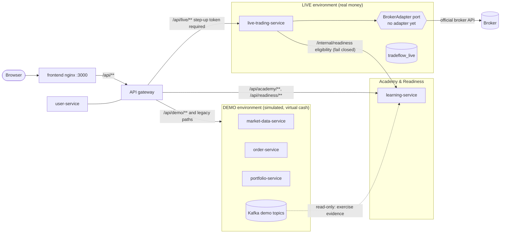
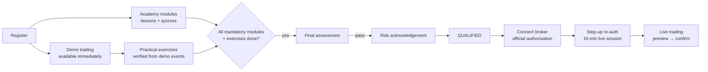
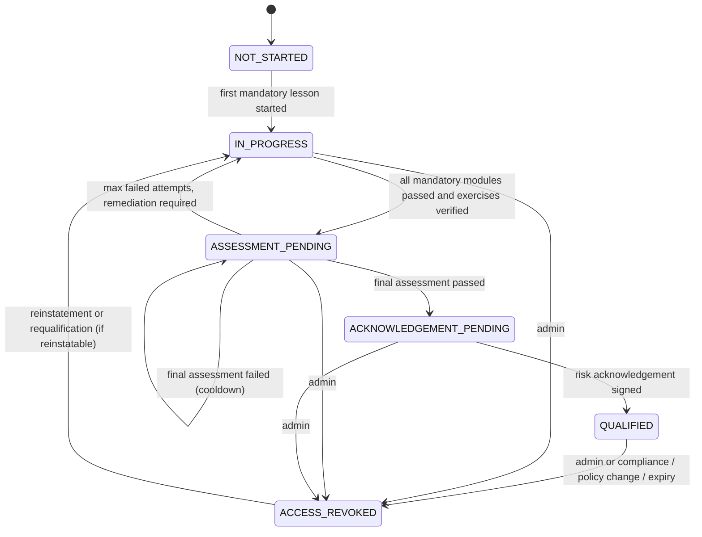

# TradeFlow dual-mode trading: architecture and implementation plan

> **Status: approved 2026-10-31 (decisions D1–D8 below), implementation in progress.** Branch
> `feature/dual-mode-trading`, based on `feature/complete-tradeflow` at `0545e1d`, the stable simulated
> version. See [Implementation progress](#implementation-progress). No broker has been chosen, and no
> broker-specific code will be written before that choice is approved.

**TradeFlow: Learn. Practice. Trade responsibly.**

This is one application with three areas:

| Area | Who | Money |
|---|---|---|
| **Demo trading** | every registered user | virtual cash, simulated prices |
| **Trading Academy + Readiness** | every registered user | none |
| **Live trading** | users the backend has verified as `QUALIFIED`, who have also authorised a broker through the broker's official flow | real funds held at the broker |

Passing the readiness assessment does not replace the broker's eligibility checks, KYC or any
regulatory requirement. TradeFlow's gate is an additional control, not a substitute for those.

---

## 1. Current architecture assessment

### What exists (verified in code)

| Component | Role today | Database |
|---|---|---|
| `api-gateway` (:8000) | Single entry point; JWT and roles checked at the edge; Eureka `lb://` routing; circuit breakers; denies `/internal/**` | – |
| `discovery-server` | Eureka | – |
| `user-service` | Registration, login with throttling, HS256 JWT issuing (8 h, roles `USER`/`ADMIN`) | `tradeflow_user` |
| `market-data-service` ×2 | Seeded random-walk prices (14 INR instruments), history, watchlists, price alerts | `tradeflow_market_data` |
| `order-service` | MARKET/LIMIT orders, saga owner, simulated execution | `tradeflow_order` |
| `portfolio-service` | Virtual cash (₹10,00,000 deposit), reservations, settlement, ledger, analytics, reconciliation, AI assistant | `tradeflow_portfolio` |
| `tradeflow-common` | Event envelope, outbox, idempotent inbox, DLT tooling, JWT config, ProblemDetail errors | – |
| `frontend` (:3000) | React app; nginx proxies `/api` to the gateway (same origin; the gateway has no CORS) | – |

Kafka topics: `users.registered`, `orders.placed|reserved|rejected|cancelled|released`,
`trades.executed|settled`, `prices.updated` (each with a `.DLT`).

### What this means for dual mode

**Strengths to keep**
- Database-per-service, outbox and idempotent consumers, ProblemDetail errors.
- A single gateway entry point, so new access rules can be enforced at the edge and again in each service.
- The whole existing engine is already simulated end to end: every price carries `source: SIMULATED`.
  That makes it a natural, self-contained **demo environment**.

**Gaps that matter for live trading**

| # | Gap | Why it matters |
|---|---|---|
| G1 | **One shared HS256 secret** across all services | Any service holding the secret can mint a token for any user or role. That is unacceptable once tokens unlock real money. |
| G2 | No notion of *environment* in APIs, events or data | Nothing in the code itself stops a demo concept from leaking into live, or the reverse. |
| G3 | 8 h tokens with no step-up or revocation | A stolen token could place real orders for hours. |
| G4 | PAN stored in plaintext (`users.pan_number`) | Acceptable for a simulator; not for a real-money product (PII). |
| G5 | Single simulated price per instrument (no bid/ask), no STOP orders | Academy topics (bid/ask, stop-loss) cannot be practised exactly as they work at a broker. |
| G6 | Alerts emit no events | Practical exercises built on alerts cannot be verified from the event stream. |
| G7 | Docker VM is about 4 GiB and the stack uses about 2.8 GiB | Two more JVM services push the memory ceilings past 4 GiB. |

---

## 2. Proposed dual-mode architecture



### Decisions

1. **The existing engine becomes DEMO, unchanged.** The market-data, order and portfolio services keep
   their code and databases. They never gain a broker dependency. Existing paths keep working, and the
   gateway adds explicit `/api/demo/**` aliases. The frontend moves to those aliases so every demo call
   is visibly labelled.
2. **New `learning-service`** owns the Academy content, quizzes, practical exercises, the **readiness
   state machine** and its **audit log** (DB `tradeflow_learning`). It is the only authority on
   readiness.
3. **New `live-trading-service`** owns everything involving real money: broker connections, encrypted
   broker tokens, live market data, live orders, synced funds/holdings/positions/trades, risk limits
   and the kill switch (DB `tradeflow_live`, a separate database and credentials). Brokers sit behind a
   `BrokerAdapter` port. Until a broker is approved, the only implementation is `DisabledBrokerAdapter`,
   which refuses everything.
4. **Live access is decided server-side at every sensitive call.** The rule is in §5. It is never
   decided by a frontend flag or a JWT claim alone: readiness is checked live with
   `learning-service`, and the check fails closed.
5. **Physical separation, not just labels.** Separate services, databases, DB users, Kafka topics and
   (in production) network egress. Only `live-trading-service` may reach the internet or the broker.

### How each separation rule is enforced

| Rule | Enforcement (more than one layer) |
|---|---|
| Demo orders never reach a broker | Demo services have no broker client on the classpath (ArchUnit test). Broker egress is allowed only from `live-trading-service` (network policy in prod). Live code accepts no demo topic. |
| Live orders never enter the simulated engine | `live-trading-service` never publishes to demo topics. Its events use `live.*` topics. Events gain an `environment` field: demo consumers reject `LIVE` and live consumers reject `DEMO`, both to the DLT with an alert. |
| Virtual cash never shown as broker funds | Live funds come only from broker sync into `tradeflow_live`. No code path reads `tradeflow_portfolio` from live (no DB credentials, no Feign client; ArchUnit). |
| Simulated prices never shown as live | Simulated quotes keep `source: SIMULATED`. Live quotes carry `source: <BROKER>`, `environment: LIVE` and `asOf`. Live code never queries market-data-service. The UI shows a LIVE quote only if `environment == LIVE`. |
| Separate portfolios, histories, records | Separate DBs and tables. Live order IDs are prefixed (`L-…`) and demo order IDs stay UUIDs, so a mixed-up ID fails lookup instead of matching. |
| Labelled everywhere | Gateway response header `X-TradeFlow-Environment: DEMO\|LIVE`. Every live DTO has `environment`. Separate frontend route trees and a distinct LIVE theme (persistent red/amber banner). |

---

## 3. Database and entity changes

### Existing databases: additive only

| DB | Change |
|---|---|
| `tradeflow_user` | `V2`: encrypt PAN at rest (envelope encryption, plus a hash for lookups) or stop collecting it (**decision D7**). Add `token_version` per user, to invalidate tokens on revocation or password change. |
| `tradeflow_market_data` | Optional (**D3**): `alert` events for exercise verification. Optional (**D2**): simulated bid/ask spread columns. |
| `tradeflow_order` | Optional (**D2**): `STOP_LIMIT` order type for the stop-loss exercises. |
| `tradeflow_portfolio` | None. |
| Common `outbox_events` | Envelope `environment` column, default `'DEMO'`, so existing rows stay valid. |

### `tradeflow_learning` (new, owned by `learning-service`)

| Table | Purpose / key columns |
|---|---|
| `course_module` | `id, slug, title, position, mandatory, content_version` |
| `lesson` | `id, module_id, slug, title, body_md, position, content_version` (content versioned in Git and seeded by Flyway) |
| `quiz` | `id, module_id NULL (= final assessment), version, pass_mark_pct, questions_served` |
| `question`, `question_option` | Question bank. `is_correct` **never leaves the server** before grading. |
| `lesson_progress` | `(user_id, lesson_id) PK, content_version, completed_at` |
| `quiz_attempt` | `id, user_id, quiz_id, quiz_version, served_question_ids, started_at, expires_at, submitted_at, score_pct, passed` |
| `quiz_answer` | `attempt_id, question_id, selected_option_ids, correct` |
| `exercise` | `id, slug, title, verification_rule (code), position, mandatory` |
| `exercise_completion` | `(user_id, exercise_id) PK, evidence_event_ids, evidence_json, verified_at` (verified from Kafka events, never from client claims) |
| `readiness_policy` | `version PK, required_modules, required_exercises, final_pass_mark_pct, retake_cooldown, max_failed_attempts, requalify_after, ack_text_version, active_from` |
| `readiness_status` | `user_id PK, state, policy_version, qualified_at, expires_at, row_version` (optimistic lock) |
| `readiness_event` | **Append-only audit log**: `id, user_id, seq, from_state, to_state, reason_code, actor_type (USER\|SYSTEM\|ADMIN), actor_id, policy_version, evidence_json, occurred_at, prev_hash, hash` (SHA-256 chain per user; a DB trigger forbids UPDATE and DELETE) |
| `risk_acknowledgement` | `id, user_id, policy_version, text_version, text_sha256, typed_phrase, accepted_at, client_ip, user_agent` |
| `self_exclusion` | `user_id, from, until, reason`: a voluntary live cool-off |
| `outbox_events`, `processed_events` | Shared infrastructure |

### `tradeflow_live` (new, owned by `live-trading-service`; separate DB user)

| Table | Purpose / key columns |
|---|---|
| `broker_connection` | `id, user_id, broker_code, status (PENDING\|ACTIVE\|EXPIRED\|REVOKED\|ERROR), broker_account_ref, connected_at, expires_at, last_sync_at` |
| `broker_credential` | `connection_id PK, ciphertext, nonce, wrapped_data_key, key_id, expires_at`. Encrypted with AES-256-GCM; **never logged or returned by any API** |
| `oauth_state` | `state PK, user_id, code_verifier, created_at, expires_at, consumed_at` (CSRF protection plus PKCE where the broker supports it) |
| `live_order` | `id ('L-…'), user_id, connection_id, client_order_id UNIQUE per user, broker_order_id, exchange, instrument_token, symbol, side, type, product, quantity, price, trigger_price, status, filled_qty, avg_price, confirmation_id, created_at, updated_at` |
| `live_order_event` | Append-only status history plus a hash of the raw broker payload |
| `order_confirmation` | `id, user_id, params_sha256, created_at, expires_at, consumed_at` (one-time; bound to exact order parameters) |
| `live_trade`, `funds_snapshot`, `holding_snapshot`, `position_snapshot` | Broker-synced; the **broker is the source of truth**; every row has `as_of` |
| `risk_limits` | `user_id, max_order_value, max_orders_per_day, max_daily_turnover, set_by, updated_at` (users can only lower the platform limits) |
| `kill_switch` | `scope (GLOBAL\|USER), user_id, enabled, reason, actor_id, changed_at` |
| `live_audit_log` | Every live action (connect, preview, submit, cancel, sync, errors), append-only and hash-chained |

---

## 4. API changes

All new endpoints follow the existing conventions: ProblemDetail errors with a `code`, user identity
from the JWT only, and `PageResponse` pagination.

### Demo (existing; no behaviour change)
- Gateway aliases `/api/demo/{market,watchlist,alerts,orders,trades,portfolio,assistant}/**` rewrite to
  today's paths. The old paths keep working, for `demo.sh` and the tests.
- Every demo response carries `X-TradeFlow-Environment: DEMO`.

### Academy (`learning-service`)
| Method | Path | Notes |
|---|---|---|
| GET | `/api/academy/modules` | Modules with the caller's progress |
| GET | `/api/academy/modules/{slug}` | Lessons and module quiz status |
| GET | `/api/academy/lessons/{id}` | Content |
| POST | `/api/academy/lessons/{id}/complete` | Idempotent |
| POST | `/api/academy/quizzes/{quizId}/attempts` | Server picks and shuffles the questions; returns them **without** answers |
| POST | `/api/academy/attempts/{id}/submit` | Server grades; returns the score and explanations |
| GET | `/api/academy/exercises` | Practical exercises with verification status and evidence |
| GET | `/api/academy/progress` | Overall progress |

### Readiness (`learning-service`)
| Method | Path | Notes |
|---|---|---|
| GET | `/api/readiness` | State, checklist with each requirement and its status, next step, policy version |
| POST | `/api/readiness/assessment/attempts` | Allowed only in `ASSESSMENT_PENDING` and outside the cooldown |
| POST | `/api/readiness/assessment/attempts/{id}/submit` | |
| GET | `/api/readiness/acknowledgement` | Current risk-disclosure text, version and required phrase |
| POST | `/api/readiness/acknowledgement` | `{textVersion, typedPhrase}`; recorded with IP and user agent |
| POST | `/api/readiness/self-exclusion` | Voluntary live cool-off (cannot be shortened once set) |
| GET | `/api/readiness/history` | The caller's own audit trail |
| GET | `/api/admin/readiness/{userId}` (+ `/audit`) | ADMIN; includes a chain-integrity check |
| POST | `/api/admin/readiness/{userId}/revoke`, `/reinstate` | ADMIN; mandatory reason; audited |
| GET | `/internal/readiness/{userId}/eligibility` | SERVICE role only; not routed by the gateway |

### Authentication (`user-service`)
| Method | Path | Notes |
|---|---|---|
| POST | `/api/auth/step-up` | Re-enter password (later MFA). Returns a **15-minute live-session token** with claims `env=LIVE`, `amr`, `auth_time`. |

### Live (`live-trading-service`; every response is `environment: LIVE`)
| Method | Path | Notes |
|---|---|---|
| GET | `/api/live/eligibility` | Aggregated gate status with a reason per check (works without step-up) |
| GET | `/api/live/brokers` | Configured brokers (empty until a broker is approved) |
| POST | `/api/live/broker-connections` | **Requires QUALIFIED.** Returns the broker's official authorisation URL and `state` |
| GET | `/api/live/broker-connections/callback` | Validates `state`, exchanges the code, stores the encrypted token |
| DELETE | `/api/live/broker-connections/{id}` | Disconnect; revokes at the broker where supported |
| GET | `/api/live/funds`, `/holdings`, `/positions`, `/trades`, `/orders`, `/orders/{id}` | Broker-synced; include `asOf` |
| GET | `/api/live/market/quotes` | Real quotes from the broker, labelled with source and time |
| POST | `/api/live/orders/preview` | Pre-trade checks; returns `confirmationId` (60 s, one use, bound to the parameters), charges if the broker provides them, and warnings |
| POST | `/api/live/orders` | `{confirmationId, clientOrderId, confirm: true}`; full gate re-checked; idempotent |
| POST | `/api/live/orders/{id}/cancel` | Gate re-checked |
| GET, PUT | `/api/live/risk-limits` | Users can only make limits stricter |
| POST | `/webhooks/broker/{code}` | Broker postbacks; signature-verified; separate gateway route; no JWT |
| POST | `/api/admin/live/kill-switch` | ADMIN; global or per user |

---

## 5. User journey and access control

### Journey



### Readiness state machine (server-side only)



- **One transition function.** `ReadinessStateMachine.transition(current, trigger, evidence)` lists
  every allowed edge; anything else throws. This mirrors the existing `OrderStatus.allowedNext()`.
- **Every transition is an audit event** in the same transaction as the status update: actor, reason
  code, policy version, evidence and a hash chain. Admin actions require a reason.
- **Policy versioning.** A requirement change creates a new policy version. Users qualified under an
  older version keep access unless the new policy is flagged `requires_requalification`; in that case
  they move to `ACCESS_REVOKED (POLICY_CHANGED)` with a remediation path.
- **Expiry.** `QUALIFIED` can expire (proposed: 12 months) and become `ACCESS_REVOKED (EXPIRED)`, with a
  refresher path. (**D4**)
- **Self-exclusion** does not change readiness. It is a separate gate that blocks live trading until
  its end date.

### Readiness must not reward profit or activity
- Requirements are knowledge (quizzes), **specific, bounded** practical actions and acknowledgements.
  **Demo P&L, win rate, trade count and volume are never inputs.**
- Each exercise needs a fixed small number of actions. Extra trades never count. There are no streaks,
  leaderboards, trade-count badges or time pressure.
- Exercises verified from demo events (no profit criteria):
  1. Place a MARKET order and read its execution (`trades.executed`).
  2. Place a LIMIT order away from the market and cancel it (`orders.cancelled`).
  3. Position sizing: place a buy no larger than a stated share of the account (order notional checked
     against the portfolio value at placement time).
  4. Review your risk report and answer a short reflection question (server-graded).
  5. Stop-loss practice: with a STOP order type (**D2**), or with a protective price alert (needs
     alert events, **D3**).
- Quiz rules: questions are drawn and shuffled on the server, attempts are time-limited, retakes have a
  cooldown, and answers are never sent to the client before grading.

### The live gate (evaluated by `live-trading-service` on every state-changing call)

```
allowed = readiness(userId) == QUALIFIED          // synchronous call to learning-service; fail closed
      AND NOT selfExcluded(userId)
      AND token.env == LIVE AND token.auth_time ≥ now − 15 min   // step-up
      AND killSwitch(GLOBAL) off AND killSwitch(user) off
      AND brokerConnection(userId).status == ACTIVE (for orders and data)
      AND riskLimits pass (for orders)
      AND confirmation valid, unused, parameters match (for orders)
```

- The gateway requires a step-up token for mutating `/api/live/**` calls (layer 1). The service
  re-checks everything (layer 2). An unreachable `learning-service` means **deny**.
- Broker connection itself requires `QUALIFIED`. If readiness is revoked, the live service is told
  (`readiness.changed` event), marks the user's connections `REVOKED`, revokes the broker token where
  the broker supports it, and blocks new orders. Open orders at the broker are **not** auto-cancelled
  without the user; the user is notified and can still cancel them. (**D5**)

---

## 6. Security considerations

| Threat | Mitigation |
|---|---|
| Frontend tampering or a forged "qualified" flag | All gates are server-side. JWTs carry no readiness claim the services trust. Eligibility is fetched live and fails closed. |
| Token minting by a compromised service (G1) | **Before any live phase:** move to **RS256/ES256 with JWKS**. Only user-service holds the private key; others hold the public key. |
| Stolen session token | Step-up live session (15 min, re-authentication), `token_version` revocation, CSP (already strict), tokens in `sessionStorage`. MFA/TOTP for step-up is recommended before going live (**D6**). |
| Broker credential theft | TradeFlow never sees broker passwords or TOTP: only the broker's official redirect authorisation. Per-user tokens are stored with **envelope encryption** (AES-256-GCM data key wrapped by a KMS key; a local master key from a Docker secret in development) with key IDs for rotation. Tokens are never logged or returned, and are deleted on disconnect. The app-level broker API secret lives in a secret manager, never in Git or `.env.example`. |
| OAuth CSRF or code interception | One-time `state` with expiry, bound to the user; PKCE where supported; exact redirect URI registered with the broker. |
| Double submission or replay | `clientOrderId` idempotency plus a one-time `confirmationId` bound to a hash of the parameters (60 s). |
| Webhook spoofing | Signature verification and timestamp window. Webhooks only trigger a re-sync from the broker API; their payloads are never trusted for state on their own. |
| Mixing environments | Separate services, databases, DB users and topics; `environment` on events, checked by consumers; ArchUnit dependency rules; contract tests. |
| Insider or admin abuse | Admin actions require a reason and are hash-chain audited. Optional four-eyes reinstatement; the kill switch is audited. |
| Runaway trading | Platform maximum limits, user-lowerable limits, per-day order caps, kill switch, rate limits on `/api/live/orders`. |
| PII (G4) | Encrypt PAN or stop collecting it (KYC is the broker's job). Minimise and redact PII in logs. |
| Regulatory | Not investment advice, as the UI already states. Broker KYC and eligibility apply. Exchange and SEBI rules for API-based retail orders (e.g. the retail algo framework: static IPs, order-rate thresholds, broker registration) **must be confirmed with the chosen broker before Phase 6**. Record retention per the broker's and the regulator's requirements. |

---

## 7. Phased implementation plan

Every phase leaves the application working, adds tests, and keeps demo behaviour identical.

| Phase | Scope | Gate to continue |
|---|---|---|
| **0** (done) | Checkpoint the stable simulated version (`0545e1d`); branch `feature/dual-mode-trading`; this design | **Your review** |
| **1. Environment foundations** | `environment` on event envelopes (default DEMO) with consumer checks; gateway `/api/demo/**` aliases and `X-TradeFlow-Environment`; frontend restructured into `/demo`, `/academy`, `/readiness`, `/live` route trees with DEMO and LIVE labelling; ArchUnit separation rules. No functional change to demo. | All existing tests plus the E2E suite green |
| **2. Security prerequisites** | RS256/JWKS migration; `token_version` revocation; step-up endpoint; PAN decision (D7) | Security tests green |
| **3. Academy** | `learning-service` (DB, gateway route, Eureka); the 10 modules (content written by me, **reviewed by you**); module quizzes with server grading; progress; Academy UI | Content review |
| **4. Readiness** | State machine, policy versioning, hash-chained audit, exercise verification from demo events, final assessment, risk acknowledgement, self-exclusion, admin revoke/reinstate; readiness UI | State-machine and audit tests; E2E path to QUALIFIED |
| **5. Live skeleton (no broker)** | `live-trading-service` with `DisabledBrokerAdapter`, `tradeflow_live` schema, full gate (fail closed), credential vault, kill switch, risk limits, confirmation flow (tested against a **test-only fake adapter**), live UI shell showing "No broker configured" | Tests prove that unqualified users, stale step-up, kill switch and an unreachable learning-service all **deny** |
| **6. Broker integration** (needs **your broker approval**) | Adapter for the chosen broker: authorisation, instrument master, quotes, funds/holdings/positions sync, read-only first | Read-only verified with your own account |
| **7. Live orders** | Order placement behind a feature flag, postbacks plus polling reconciliation, low default limits, staged rollout to your account only | Your explicit go-ahead |
| **8. Hardening** | Threat-model review, observability and alerting, backup and retention, legal disclosures | – |

---

## 8. Decisions needed from you

| # | Decision | My recommendation |
|---|---|---|
| D1 | New services (`learning-service`, `live-trading-service`) vs extending existing ones | **New services**: the clearest separation boundary and blast radius |
| D2 | Add a simulated **STOP/STOP-LIMIT** order type and a **bid/ask spread** to the demo engine so the Academy topics can be practised | **Yes**, in Phase 3/4 (additive to order-service and market-data) |
| D3 | Emit alert events so alert-based exercises can be verified | Yes, if D2 is "no" |
| D4 | Readiness policy: module pass mark, final pass mark, cooldown, attempt limit, requalification period | 80% modules, 85% final, 24 h cooldown, 3 attempts before remediation, 12-month expiry |
| D5 | When readiness is revoked: block new orders only, or also cancel open broker orders | Block new orders and notify; never auto-cancel without the user |
| D6 | MFA (TOTP) for live step-up before going live | **Yes**, before Phase 7 |
| D7 | PAN: encrypt at rest, or stop collecting it | **Stop collecting it** (the broker does KYC); otherwise encrypt |
| D8 | Docker memory: raise the Docker VM to about 6 GiB, or run 1 market-data replica locally | Raise to 6 GiB (keeps the load-balancing demo) |
| D9 | Broker (Phase 6) | **Your choice later.** Criteria: official retail API with redirect-based authorisation, sandbox or paper environment, postbacks, documented rate limits and exchange-compliance support, cost |

---

## Implementation progress

| Phase | Commit | State |
|---|---|---|
| 1. Environment foundations | `99ea7b3` | Done: event environment check, `/api/demo/**`, `X-TradeFlow-Environment`, ArchUnit rules, DEMO UI |
| 2. Security prerequisites | `ed5b14f` | Done: RS256 + public key ring, service client credentials, 15-min tokens + rotating refresh cookie, TOTP + recovery codes, step-up, audited admin MFA reset, PAN no longer collected. See [SECURITY.md](SECURITY.md) |
| 3. Academy (+ D2) | phase 3 commit | Done: learning-service, 10 modules / 20 lessons / 80 module questions + 25 final-assessment questions, server-graded quizzes, versioned readiness policy v1; simulated bid/ask and SELL stop / stop-limit in the demo engine |
| 4. Readiness | phase 4 commit | Done: state machine (incl. REVIEW_REQUIRED), hash-chained audit (append-only trigger on PostgreSQL), exercises verified from DEMO events, final assessment with cooldown/attempt limit, authorised reviewer, versioned risk acknowledgement, self-exclusion, admin revoke/reinstate, policy publishing, fail-closed internal eligibility API |
| 5. Live skeleton (no broker) | phase 5 commit | Done: live-trading-service with only `DisabledBrokerAdapter`, fail-closed `LiveAccessGuard`, encrypted credential vault, parameter-bound one-time confirmations, limits, kill switches, hash-chained live audit, readiness notifications, gateway LIVE route, LIVE UI. See below |
| 6–7. Broker, live orders | – | **Blocked on your broker approval** |

### Decisions as approved (2026-10-31)

* **D1** New `learning-service` and `live-trading-service`; demo services keep their behaviour.
* **D2** Minimal simulated spread and SELL stop / stop-limit. Spread: 10 bps by default
  (`TRADEFLOW_MARKET_SPREAD_BPS`); MARKET buys fill at the ask and sells at the bid; LIMIT orders compare the
  limit with the ask (buy) or bid (sell); portfolio valuation stays at the mid. **This is a deliberate change to
  demo execution prices** (previously everything traded at the mid). Events and quotes from before the change
  carry no bid/ask and are treated as bid = ask = mid; the existing order-service tests use such quotes, and
  `SpreadAndStopOrderTest` covers the spread. Stops are SELL-only (the demo is long-only), must be placed below
  the current bid, trigger on the bid, and expire like resting limit orders.
* **D3** No alert events.
* **D4** Policy v1: 80% modules, 85% final, 24 h final-assessment cooldown, review after 3 failed final attempts,
  12-month validity, stored in `readiness_policies` (immutable versions; quiz attempts record the version).
* **D5** Revocation blocks new live orders and notifies; existing broker orders are never auto-cancelled and stay
  manageable.
* **D6** TOTP with enrolment, recovery codes and an audited, non-bypass recovery procedure (SECURITY.md).
* **D7** PAN no longer collected; existing values untouched pending [PAN_MIGRATION.md](PAN_MIGRATION.md).
* **D8** See the resource section below.

### Readiness as implemented (phase 4)

* **States:** NOT_STARTED → IN_PROGRESS → ASSESSMENT_PENDING → ACKNOWLEDGEMENT_PENDING → QUALIFIED, with
  REVIEW_REQUIRED (after the policy's maximum failed final attempts) and ACCESS_REVOKED (admin, expiry, or a
  policy version that requires requalification). Only ACKNOWLEDGEMENT_PENDING can lead to QUALIFIED.
* **Evidence:** all mandatory modules (lessons read, quiz ≥ module pass mark) and the policy's exercises.
  Exercises are started explicitly and completed only from DEMO order events after the start
  (market buy filled; limit order cancelled by the user; sell stop accepted; position size equal to the scenario).
* **Final assessment:** 20 of 25 questions, 40 minutes, ≥ 85%. A failed or abandoned attempt starts a 24 h pause;
  the third failure in a cycle moves the user to REVIEW_REQUIRED.
* **Authorised reviewer:** role `READINESS_REVIEWER` (or ADMIN), never the user themselves. Decision: allow a new
  cycle of attempts, or require named modules to be redone first; notes ≥ 20 characters. Recorded in
  `readiness_reviews` and in the audit chain with actor type REVIEWER. Demo account: `reviewer@tradeflow.dev`.
* **Acknowledgement:** versioned text (academy/acknowledgement/v1.md), typed phrase, stored with the text hash,
  time, IP and user agent. It states that passing is not a suitability judgement or a guarantee of competence.
* **Audit:** `readiness_events` is hash-chained per user (SHA-256 over the previous hash and every field);
  admins can verify the chain; on PostgreSQL a trigger rejects UPDATE/DELETE on it and on acknowledgements.
* **Eligibility:** `GET /internal/readiness/{userId}/eligibility` (SERVICE token only) re-evaluates on every call:
  QUALIFIED, not expired, not superseded by a requalification policy, not self-excluded.

### Live skeleton as implemented (phase 5)

No broker is integrated. `tradeflow.live.broker` must be `none` (anything else refuses to start), and the only
production `BrokerAdapter` is `DisabledBrokerAdapter`, which refuses every call with 503 `BROKER_NOT_CONFIGURED`
(an ArchUnit rule fails the build if another implementation appears). So **no request can reach a broker and no
real order can be placed**; the order path is exercised only in tests with a test-only fake broker.

* **Independent authorisation (`LiveAccessGuard`, in the service; the gateway is only a first line).** Every
  state-changing call needs a step-up token (audience `tradeflow-live`, `amr` = pwd + otp, `auth_time` ≤ 10 min).
  The guard then asks user-service (`/internal/users/{id}/session-state`) whether the account is active, the
  token version is current and MFA is still on, checks the global and per-user kill switches, and asks
  learning-service for eligibility. Any check that cannot be completed refuses the action
  (`LIVE_CHECK_UNAVAILABLE`). Every refusal is audited with its code.
* **What each action needs (D5).** Connect a broker, preview and place orders: everything above. Cancel an
  order, disconnect, raise a limit: step-up and a current session, but not readiness or "not halted". Losing
  readiness or a halt therefore blocks new exposure only; inspecting and cancelling stay possible, and
  nothing ever cancels a broker order automatically.
* **Broker linking.** The broker's own authorisation page (redirect + one-time code, `state` stored hashed and
  single use, PKCE verifier encrypted, 10 minutes, bound to the user). TradeFlow never sees broker passwords or
  OTPs.
* **Broker tokens.** AES-256-GCM with live-trading-service's own key ring (separate from user-service's),
  bound to the connection id (a ciphertext moved to another row will not decrypt). Decrypted only inside
  `CredentialVault` at call time. No getter or response returns them and `toString` redacts them. Disconnecting
  revokes and erases them.
* **Orders.** Preview validates and checks limits, then returns a one-time confirmation (60 s) bound to the user
  and a SHA-256 of the exact parameters. Placing re-checks limits under a per-user row lock, consumes the
  confirmation, stores the order (`L-` ids), then calls the broker outside any DB transaction. A definite broker
  refusal is REJECTED; anything unclear is UNKNOWN ("check your broker before retrying"), never retried
  automatically. `clientOrderId` makes retries idempotent.
* **Limits.** Platform ceilings (default 25,000 per order, 10 orders/day, 100,000 turnover/day, IST trading day);
  users may only set stricter values. Raising a limit again needs step-up (decided by the server).
* **Kill switches.** ADMIN, reason of 10+ characters, audited; per-user changes notify the user. They block new
  orders and new broker links only.
* **Audit.** `live_audit_log`: every allowed and refused action, hash-chained per user (platform chain = user 0),
  written in its own transaction so refusals survive the failed request; append-only trigger on PostgreSQL;
  ADMIN can verify the chain.
* **Notifications.** `readiness.changed` (PLATFORM events; the LIVE codec refuses DEMO events) creates an in-app
  notice when access is gained or lost. The event never grants access; the guard asks every time.
* **Gateway.** `/api/live/**` and `/api/admin/live/**` go only to live-trading-service and are labelled `LIVE`.
  POSTs to `/api/live/orders/**` and `/api/live/broker/**` need a step-up token at the edge too; a step-up token is
  refused everywhere outside `/api/live/**` (including admin paths).

### D8: measured resources and recommendation (2026-10-31)

Measured with `docker stats` and inside the Docker VM (`free`, `/proc/vmstat`, `/proc/pressure`):

| Point in time | Containers' memory in use | Notes |
|---|---|---|
| Baseline (10 containers, before this work) | 2,956 MiB | VM has 3.82 GiB |
| After phase 2 | 2,971 MiB | |
| With learning-service (phase 3/4) | 2,880–3,050 MiB | learning-service ≈ 305–330 MiB (limit 512 MiB) |
| VM during a rebuild with the stack running | 3,447 MiB used, **468 MiB available, swap 995/1,023 MiB** | **4 OOM kills** (incl. portfolio-service), Kafka restarted twice, CPU pressure 41% (5-min avg) |

Effects observed: requests stalling 15–60 s after restarts, orders staying PENDING while consumers rejoin, one
service OOM-killed during an image build. These are resource symptoms, not logic faults (all tests pass once
memory is relieved; with one market-data replica the readiness E2E dropped from >150 s to 22 s).

**Estimate with phase 5:** live-trading-service ≈ 300–350 MiB in use (512 MiB limit, same profile as
learning-service). Steady state ≈ 3.4 GiB of container memory; image builds inside Docker add ≈ 1–1.5 GiB
(Maven stage `-Xmx768m`, Node build). Sum of container limits ≈ 5.9 GiB.

**Measured with phase 5 (11 app containers):** live-trading-service 371 MiB in use; containers ≈ 2.75 GiB;
the VM had **365 MiB available and swap 1,022/1,024 MiB full**, with memory-pressure stalls (Eureka heartbeat
timeouts, the gateway briefly finding "no servers" for user-, order- and portfolio-service). No new OOM kill.
The full stack no longer runs reliably in the 4 GiB VM.

**Recommendation:** set Docker Desktop to **6 GiB minimum, 8 GiB recommended** (8 GiB lets you rebuild while
the stack runs without swapping), keeping 4+ CPUs. If you must stay at 4 GiB: run one market-data replica
(`docker compose --profile apps up -d --scale market-data-service=1`) and stop the stack before rebuilding images.
I have not changed your Docker settings.

**Superseded (2026-11-01):** you chose to stay at 4 GiB (8 GB Mac). After JVM, Kafka and PostgreSQL tuning
the full stack uses ≈2.8 GiB with ≈30 MiB swap, and the full browser suite passes against it. See
[DEVELOPMENT_RESOURCES.md](DEVELOPMENT_RESOURCES.md).

### Order reconciliation (broker-independent part, 2026-11-01)

Implemented and tested against the test-only fake broker; dormant in production because
`DisabledBrokerAdapter.enabled()` is false.

* **No duplicates while an outcome is uncertain.** While a user has an order in SUBMITTING, UNKNOWN or
  NEEDS_REVIEW, preview and placement answer `409 UNRESOLVED_ORDER` (checked under the per-user lock).
  Retrying the *same* request (same clientOrderId) still returns the existing order and sends nothing.
* **Never resubmitted.** `OrderReconciler` only reads the broker's order book. It never places, retries or
  cancels.
* **Matching by the clientOrderId tag only**, never by a fuzzy symbol/quantity/price match.
  * Found once: LINKED, takes the broker's id and state.
  * Found twice: NEEDS_REVIEW (DUPLICATE_AT_BROKER), and neither order is cancelled.
  * Not found: stays UNKNOWN for `tradeflow.live.reconcile-absence-window` (15 min; brokers can list orders
    late), then NEEDS_REVIEW (NOT_FOUND_AT_BROKER).
  * Broker unreachable, or no connection to the same broker account: no change.
* **Timeouts, delayed and duplicate answers.**
  * A SUBMITTING order is left alone for `reconcile-in-flight-grace` (2 min). After that it is treated as
    interrupted (crash recovery).
  * A late acknowledgement can only add a missing broker id; a contradicting one moves the order to
    NEEDS_REVIEW (BROKER_ID_MISMATCH).
  * Broker snapshots are applied monotonically: older `updatedAt` is ignored, terminal states stay terminal,
    and fills never decrease. Applying the same snapshot twice is a no-op.
  * Each order is updated in its own transaction with optimistic locking.
* **Status refresh** for OPEN, PARTIALLY_FILLED and CANCEL_REQUESTED orders, by broker order id. It runs every
  60 s in the background, or on demand via `POST /api/live/reconciliation`.
* **The user closes a review** with `POST /api/live/orders/{id}/resolve` (step-up) after checking their broker
  account. Nothing is sent to the broker; the order keeps counting toward daily limits.
* **Audit and notifications.** Every decision that changes an order is written to the live audit chain
  (`RECONCILE_ORDER`, `RESOLVE_ORDER` with the step-up summary). On-demand checks also record the passes that
  changed nothing. The user is notified when an order needs review (ORDER_NEEDS_REVIEW) and when an uncertain
  order is found (ORDER_CONFIRMED).

**Broker-dependent, for phase 6 (needs your broker choice):**
1. **Order tag.** The adapter must send TradeFlow's clientOrderId as the broker's order tag and return it in
   `BrokerOrder.clientOrderId`. Brokers limit tag length and characters (some to 20 characters), so the
   adapter may need a shorter deterministic tag derived from the clientOrderId. Without a tag, uncertain
   orders can only ever go to NEEDS_REVIEW.
2. **Status mapping** from the broker's vocabulary onto OPEN / PARTIALLY_FILLED / FILLED / CANCELLED /
   REJECTED / EXPIRED, and which of its timestamps is `updatedAt`.
3. **Order-book coverage.** Does the broker list only today's orders? What are its rate limits? Together these
   set the absence window and the polling interval.
4. **Postbacks / webhooks** (optional, faster than polling). They need the broker's signature verification and
   would feed the same `applyBroker` path.
5. **Which errors are definite.** The adapter decides which broker errors are definite rejections (4xx →
   REJECTED) and which are uncertain (UNKNOWN).
6. **Real-money end-to-end test** with your account and minimal limits (phase 7).
